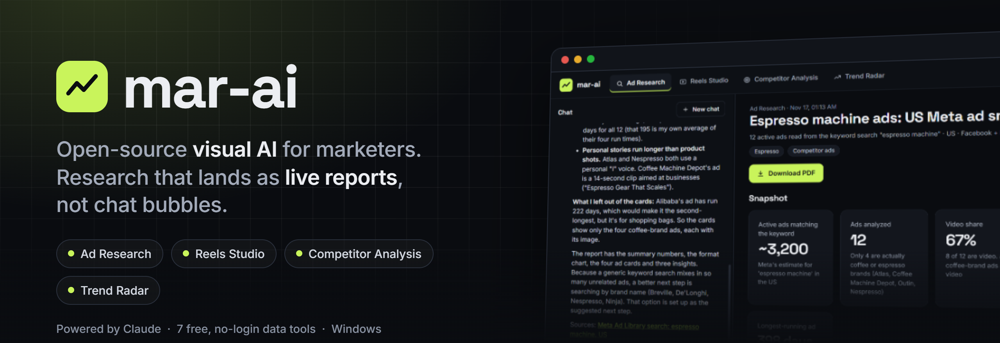
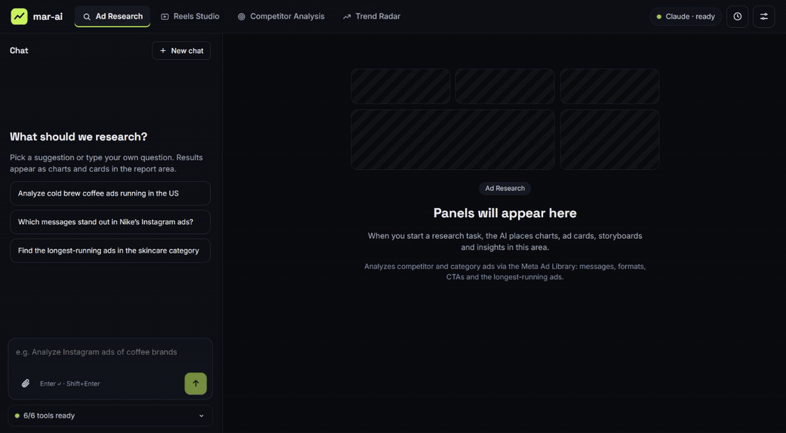
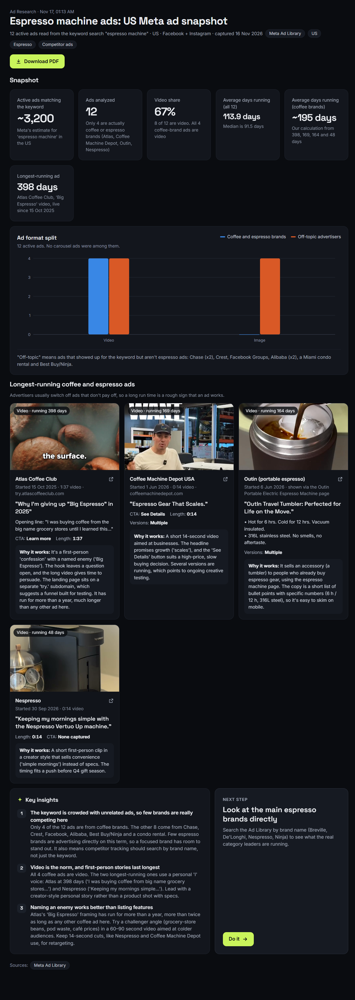
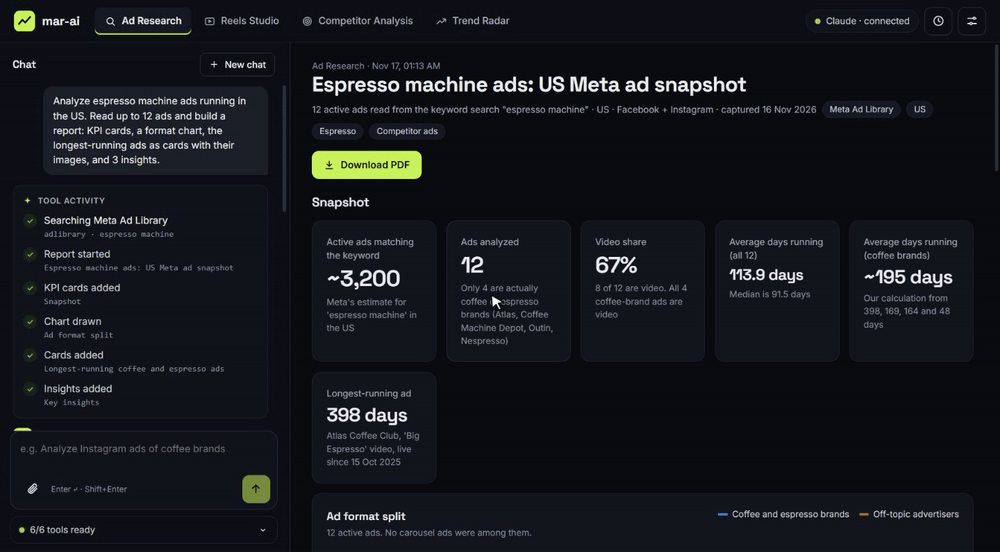
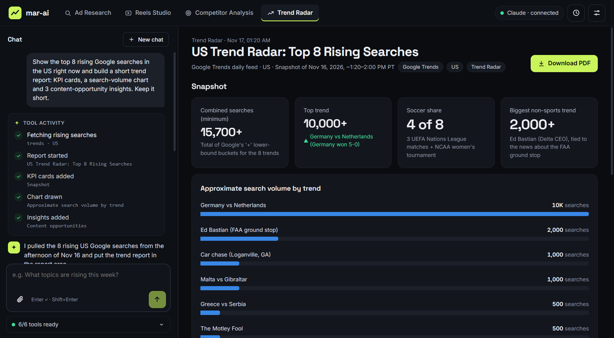
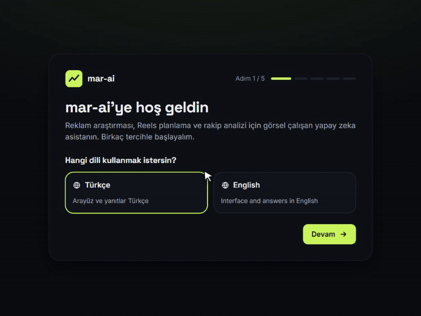
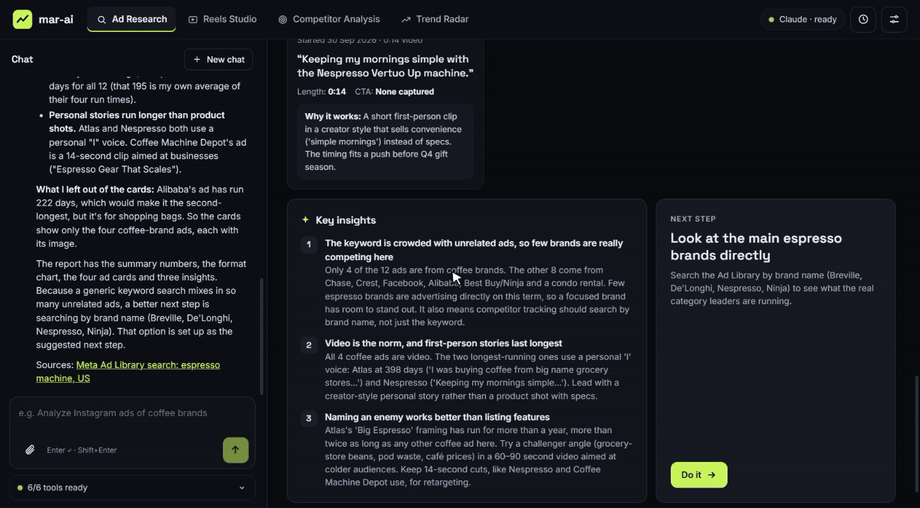
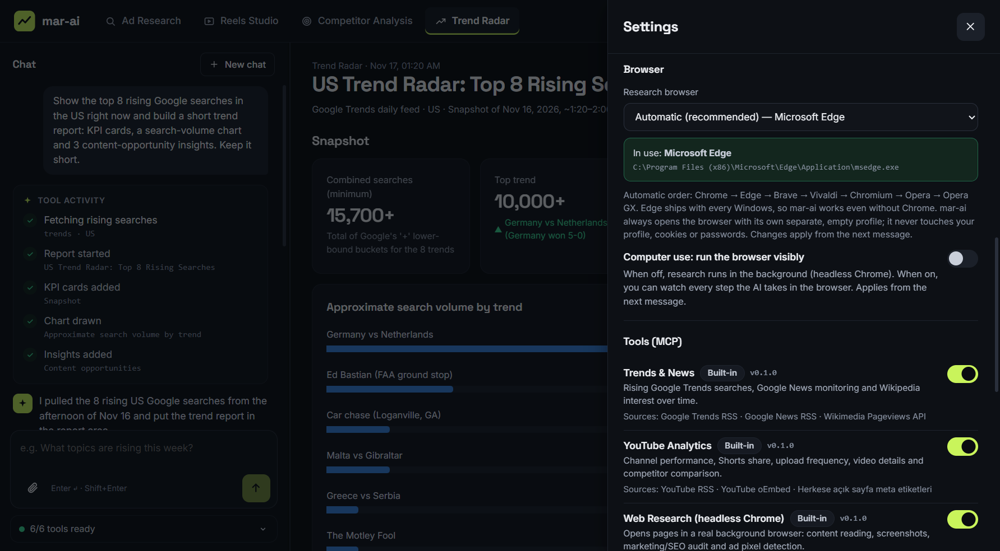
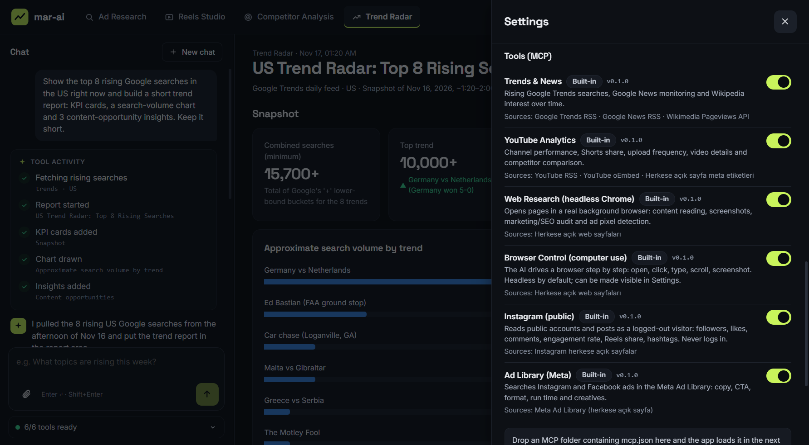
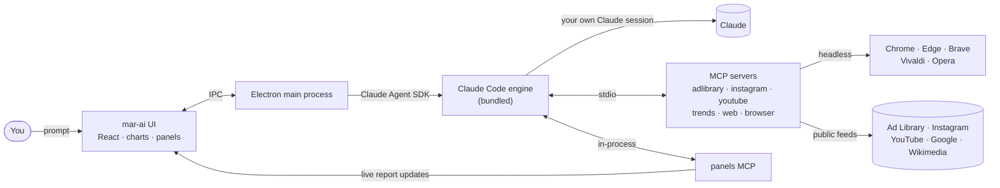

<a id="readme-top"></a>

<div align="center">

<picture>
  <source media="(prefers-color-scheme: dark)" srcset="docs/media/banner-dark.png">
  <source media="(prefers-color-scheme: light)" srcset="docs/media/banner-light.png">
  
</picture>

<br>

**Ad research, Reels planning, competitor analysis and trend tracking —<br>delivered as live, interactive reports instead of walls of chat text.**

<p>
  <a href="https://github.com/EthYusuf/mar-ai/releases/latest/download/mar-ai-Setup.exe"></a>
  <br>
  <sub>Windows 10 / 11 · always the latest version · <a href="https://github.com/EthYusuf/mar-ai/releases">all releases</a></sub>
</p>

<p>
  <a href="#-quick-start"><b>Quick start</b></a> &nbsp;·&nbsp;
  <a href="#-how-it-works">How it works</a> &nbsp;·&nbsp;
  <a href="docs/MCP-DEVELOPMENT.md">Build your own MCP</a> &nbsp;·&nbsp;
  <a href="README.tr.md">Türkçe</a>
</p>

<p>
  <a href="https://github.com/EthYusuf/mar-ai/releases/latest"></a>
  <a href="https://github.com/EthYusuf/mar-ai/releases"></a>
  
  <a href="LICENSE"></a>
  <br>
  
  
  
  <a href="https://github.com/EthYusuf/mar-ai/actions/workflows/ci.yml"></a>
</p>



<sub><i>A real, unedited run (sped up): “Analyze espresso machine ads running in the US” → Meta Ad Library → live report with KPIs, a format chart, ad cards and insights.</i></sub>

</div>

<br>

## ✨ Why mar-ai?

Most AI assistants answer marketing questions with paragraphs. Marketers need **evidence they can show**: numbers, charts, the actual ads, a plan they can hand to a video editor. mar-ai pairs Claude with real, public data sources and draws the answer into a professional report panel next to the chat.

<table>
<tr>
<td width="50%" valign="top">

**📊 Reports, not chat bubbles**<br>
KPI cards, bar/column/line charts with hover tooltips, ad and post cards with real creatives, scene-by-scene storyboards, tables and insights. One click exports the report to PDF.

</td>
<td width="50%" valign="top">

**🔑 Your Claude, no API key**<br>
The Claude Code engine ships inside the app and runs on <i>your own</i> Claude session. Sign in once in the official Claude Code window and you are done; there is no API key field anywhere.

</td>
</tr>
<tr>
<td valign="top">

**🌐 Real data, never a login**<br>
Six built-in MCP servers read <i>free, public, no-login</i> sources: Meta Ad Library, public Instagram pages, YouTube RSS, Google Trends &amp; News, Wikimedia and any website through a headless browser.

</td>
<td valign="top">

**🧩 MCP-first and open source**<br>
Every data source is a small MCP server in <code>mcps/</code>. Drop in a folder, tag a release and every installed app updates itself. MIT licensed.

</td>
</tr>
</table>

<details>
<summary><b>Table of contents</b></summary>

- [Features](#-features)
  - [Ad Research](#-ad-research) · [Reels Studio](#-reels-studio) · [Competitor Analysis](#-competitor-analysis) · [Trend Radar](#-trend-radar)
  - [Make it yours](#-make-it-yours) · [Computer use](#%EF%B8%8F-computer-use--any-chromium-browser)
- [Built-in data sources (MCP)](#-built-in-data-sources-mcp)
- [How it works](#-how-it-works)
- [Quick start](#-quick-start)
- [Example prompts](#-example-prompts)
- [Build from source](#%EF%B8%8F-build-from-source)
- [Extend mar-ai](#-extend-mar-ai)
- [Privacy and data ethics](#-privacy-and-data-ethics)
- [Roadmap](#%EF%B8%8F-roadmap) · [FAQ](#-faq) · [Contributing](#-contributing) · [License](#-license)

</details>

<br>

## 🚀 Features

### 🔍 Ad Research

Search the **Meta Ad Library** (Facebook + Instagram ads) by keyword or brand, for any country and platform. mar-ai reads the ads like a visitor would and turns them into a report:

- **Format split** (video / image / carousel), most-used **CTAs**, landing domains and top advertisers
- **Days running** for every ad: long-running ads are usually the profitable ones, so mar-ai surfaces the “winners”
- **Ad cards** with the real creative, hook, copy, CTA and a short *why it works* analysis
- **Pixel detection** on competitor sites (Meta Pixel, TikTok Pixel, Google Ads, GA4…) shows which channels they pay for

<details>
<summary><b>See a complete report</b> (KPIs → chart → ad cards → insights)</summary>
<br>

</details>

### 🎬 Reels Studio

Plan short videos for Instagram Reels, TikTok and YouTube Shorts: **three scored hook options**, an interactive **timeline**, a **scene-by-scene storyboard** with 9:16 frames, on-screen text, shot types and audio, plus a ready-to-paste caption, hashtags, music direction and a posting tip.



### 🎯 Competitor Analysis

Put brands side by side across channels:

| Channel | What mar-ai measures |
|---|---|
| **Instagram** (public profiles) | followers, average likes &amp; comments, **engagement rate**, Reels share, posting frequency, top hashtags, best post |
| **YouTube** | average &amp; median views, uploads per week, **Shorts share** and Shorts vs long-form performance, best weekday, top videos |
| **Website** | marketing &amp; SEO health score, Open Graph / social cards, structured data, page weight, **ad &amp; analytics pixels** |

### 📈 Trend Radar

Catch what people are searching for **right now** (Google Trends daily feed for any country), monitor news about a brand or topic (Google News, with per-day volume and top sources), and compare **interest over time** for up to five topics using Wikimedia pageviews.



### 🎨 Make it yours

A first-run wizard asks for **language, theme and accent color**, checks the Claude connection and shows which browser will be used. Everything can be changed later: dark / light / system theme, four accent colors, comfortable or compact density, chat on the left or right, and a **draggable divider** to make the report as wide as you like.

<table>
<tr>
<td width="50%" valign="top"><br><sub>First-run wizard</sub></td>
<td width="50%" valign="top"><br><sub>Resize panels, switch theme, accent and layout</sub></td>
</tr>
</table>

### 🖱️ Computer use &amp; any Chromium browser

The **browser** MCP lets the AI drive a real browser step by step: open, read, click, type, scroll and take screenshots it can actually see. It runs **headless** by default; flip one switch in Settings to watch it work in a visible window.

mar-ai uses the browser you already have: **Chrome → Edge → Brave → Vivaldi → Chromium → Opera → Opera GX** (Edge ships with every Windows, so Opera or Firefox users are covered too). You can pick any detected browser or a custom path. It always opens with its **own empty profile**; your cookies, logins and passwords are never touched.



### And also

- 🗂️ **History**: every conversation and its report is saved locally and can be resumed later
- 📎 **Attachments**: drop in images, PDFs, CSV or text files (e.g. your own Instagram Insights export)
- 📄 **PDF export** with a print-optimised light layout
- 🔄 **Auto-update** from GitHub Releases, including new MCP servers
- 🌍 **English and Turkish** UI; the AI answers in your language

<p align="right"><a href="#readme-top">↑ back to top</a></p>

## 🧰 Built-in data sources (MCP)

All six are free, require **no API key and no login**, and are rate-limited and cached to stay polite.

| MCP | Tools | Source |
|---|---|---|
| `adlibrary` · Ad Library (Meta) | `meta_ads_search` · `meta_ads_screenshot` | Meta Ad Library public pages |
| `instagram` · Instagram (public) | `instagram_profile` · `instagram_post` · `instagram_compare` | Public profile &amp; post pages, read as a logged-out visitor |
| `youtube` · YouTube Analytics | `youtube_channel` · `youtube_video` · `youtube_compare` | YouTube RSS feeds, oEmbed, public page metadata |
| `trends` · Trends &amp; News | `trending_now` · `news_search` · `interest_over_time` | Google Trends RSS, Google News RSS, Wikimedia Pageviews API |
| `web` · Web Research | `web_read` · `web_screenshot` · `site_audit` | Any public web page via a headless browser |
| `browser` · Browser Control | `browser_open` · `browser_click` · `browser_type` · `browser_scroll` · `browser_screenshot` · … | Computer use in a real browser |

On top of these, Claude can use its built-in **WebSearch** and **WebFetch**, and an in-app **panels** server (`report_start`, `show_kpis`, `show_chart`, `show_cards`, `show_storyboard`, `show_insights`, `show_table`, `show_text`) that draws the report.



## 🧠 How it works



1. You type a request in one of the four modules. The module adds context so Claude knows which workflow you are in.
2. The bundled **Claude Code engine** (via the Claude Agent SDK) plans the work and calls the **MCP servers** that fetch real data.
3. Instead of dumping everything into the chat, Claude calls the **panel tools**. The app renders them instantly as KPI cards, charts, ad cards and storyboards.
4. **Skills** (`plugin/skills/*`) teach Claude each workflow: which tools to call, how to analyse and which panels to draw.
5. The chat stays short: what was done, the key findings and a pointer to the report.

<p align="right"><a href="#readme-top">↑ back to top</a></p>

## ⚡ Quick start

| Platform | Download | Notes |
|---|---|---|
| **Windows 10 / 11** (x64) | **[⬇ mar-ai-Setup.exe](https://github.com/EthYusuf/mar-ai/releases/latest/download/mar-ai-Setup.exe)** | Unsigned for now: SmartScreen → **More info → Run anyway** |
| macOS · Linux | Build from source | Packaged builds are on the [roadmap](#%EF%B8%8F-roadmap) |

The download link always serves the newest version. Once installed, mar-ai downloads updates in the background and installs them when you close it. Older versions are on the [releases page](https://github.com/EthYusuf/mar-ai/releases).

**Requirements**

- A **Claude Pro or Max** plan and a one-time sign-in to [Claude Code](https://code.claude.com/docs/en/setup) (run `claude` in a terminal and log in)
- Any Chromium browser: Chrome, Edge (built into Windows), Brave, Vivaldi or Opera

**First run**

1. Install and open mar-ai.
2. Pick language, theme and accent color.
3. On the *Claude connection* step press **Test connection**. If no session is found, **Sign in with Claude** opens the official Claude Code window.
4. Choose a module (Ad Research, Reels Studio, Competitor Analysis, Trend Radar) and start with a suggestion or your own prompt.

## 💬 Example prompts

| Module | Try |
|---|---|
| Ad Research | *Analyze the Instagram ads of Nike in the US. Which hooks and CTAs run the longest?* |
| Reels Studio | *Plan a 30-second Reel for our new cold brew: 3 scored hooks, storyboard, caption and hashtags.* |
| Competitor Analysis | *Compare @nike and @adidas on Instagram and YouTube. Who gets more engagement per post?* |
| Trend Radar | *What is rising in Google searches in Germany today? Suggest three content angles for a coffee brand.* |

## 🛠️ Build from source

**Prerequisites:** Node.js 22+ and npm, Windows 10/11 (macOS / Linux work for development).

```bash
git clone https://github.com/EthYusuf/mar-ai.git
cd mar-ai
npm install

npm run dev          # Vite hot reload + Electron
npm start            # production build, then launch
npm run test:mcps    # call every MCP against live sources (one server: npm run test:mcps -- youtube)
npm run typecheck    # TypeScript
npm run dist         # Windows installer → release/
```

<details>
<summary><b>Project structure</b></summary>

```
electron/        main process: Claude engine, MCP registry, panel tools, auto-update, PDF export
src/             React UI: onboarding, chat, report panels, charts, settings
shared/          types shared by main and UI, browser detection
mcps/            MCP servers (each: mcp.json + src/index.ts) and shared helpers in mcps/_shared
plugin/skills/   Claude skills: ad research, Reels planning, competitor analysis, trend radar
scripts/         build, dev, start and MCP test scripts
docs/            guides and README media
```

</details>

## 🧩 Extend mar-ai

**Add a data source.** Create `mcps/<id>/mcp.json` and `mcps/<id>/src/index.ts`. The build script bundles it, the installer ships it and the app loads it on start. No core changes needed. The full guide, with a template and the shared helpers, is in **[docs/MCP-DEVELOPMENT.md](docs/MCP-DEVELOPMENT.md)**.

**Teach a workflow.** Add `plugin/skills/<name>/SKILL.md` with a clear `description`; Claude loads it when relevant.

**Ship it.** Bump the version and push a tag. GitHub Actions builds the installer and publishes the release, and every installed copy updates itself:

```bash
git tag v0.2.0 && git push --tags
```

Users can also drop their own MCP folders into `%APPDATA%\mar-ai\mcps` (*Settings → Tools → Open my MCP folder*).

<p align="right"><a href="#readme-top">↑ back to top</a></p>

## 🔒 Privacy and data ethics

- **Public data only.** mar-ai never logs in anywhere, never types into password fields and never uses hidden APIs or impersonates apps.
- **Your browser stays yours.** Research runs in a separate, empty browser profile.
- **Local first.** Settings, conversations and reports are stored on your machine (`%APPDATA%\mar-ai`). Prompts go to Claude through your own Claude Code session; nothing is sent to mar-ai servers (there are none).
- **Polite by design.** Requests are paced and cached. mar-ai is a research assistant, not a scraper for bulk collection.
- Platforms may change what logged-out visitors can see or temporarily limit access; tools report this clearly. Respect each platform's terms; mar-ai is designed for public brand content, not personal accounts.

## 🗺️ Roadmap

- [x] Four modules with live report panels and PDF export
- [x] Six no-login MCP servers, computer use, any Chromium browser
- [x] Auto-update via GitHub Releases
- [ ] Signed Windows installer (no SmartScreen warning)
- [ ] macOS and Linux builds
- [ ] More sources: TikTok Creative Center, Google Ads Transparency Center, LinkedIn Ad Library
- [ ] Scheduled reports (weekly competitor digest)
- [ ] Optional engines (Codex, Gemini CLI)
- [ ] More UI languages

Have an idea? [Open a feature request](https://github.com/EthYusuf/mar-ai/issues/new?template=feature_request.yml).

## ❓ FAQ

<details>
<summary><b>Do I need an Anthropic API key?</b></summary>

No. mar-ai runs on the Claude session you create by signing in to Claude Code once. Usage counts against your Claude plan. Advanced users can still point it at a custom Claude Code binary in Settings.
</details>

<details>
<summary><b>Is it free?</b></summary>

mar-ai is free and open source (MIT). All built-in data sources are free. You need your own Claude plan (Pro or Max).
</details>

<details>
<summary><b>Does it log in to Instagram or Facebook?</b></summary>

Never. It reads exactly what a logged-out visitor can see. Private accounts, stories and hashtag pages are out of scope.
</details>

<details>
<summary><b>I don't use Chrome. Will it work?</b></summary>

Yes. Edge is built into Windows and is used automatically when Chrome is missing. Brave, Vivaldi, Chromium, Opera and Opera GX are detected too, and you can choose one in Settings.
</details>

<details>
<summary><b>Where is my data stored?</b></summary>

Locally in `%APPDATA%\mar-ai` (settings, conversations, reports, browser profile). Delete the folder to reset the app.
</details>

<details>
<summary><b>Why does the installer show a SmartScreen warning?</b></summary>

The installer is not code-signed yet. Choose <i>More info → Run anyway</i>. Signing is on the roadmap.
</details>

## 🤝 Contributing

Contributions are very welcome: new MCP servers, skills, panels, translations and bug fixes. Read **[CONTRIBUTING.md](CONTRIBUTING.md)**, open an issue to discuss bigger changes and check out [good first issues](https://github.com/EthYusuf/mar-ai/labels/good%20first%20issue).

If mar-ai helps your marketing work, **give it a ⭐**. It helps other marketers find it.

## 🙏 Acknowledgments

[Claude Agent SDK](https://code.claude.com/docs/en/agent-sdk/overview) · [Model Context Protocol](https://modelcontextprotocol.io) · [Electron](https://www.electronjs.org) · [React](https://react.dev) · [Vite](https://vite.dev) · [Puppeteer](https://pptr.dev) · [Inter](https://rsms.me/inter/) and [Space Grotesk](https://fonts.google.com/specimen/Space+Grotesk) via Fontsource · [Shields.io](https://shields.io)

mar-ai is an independent open-source project and is not affiliated with or endorsed by Anthropic, Meta, Google or YouTube. Product names are trademarks of their respective owners.

## 📄 License

[MIT](LICENSE) © mar-ai contributors. The bundled Claude Agent SDK and Claude Code engine are governed by [Anthropic's Commercial Terms of Service](https://www.anthropic.com/legal/commercial-terms).

<p align="right"><a href="#readme-top">↑ back to top</a></p>
