<a id="readme-top"></a>

<div align="center">

<picture>
  <source media="(prefers-color-scheme: dark)" srcset="docs/media/banner-dark.png">
  <source media="(prefers-color-scheme: light)" srcset="docs/media/banner-light.png">
  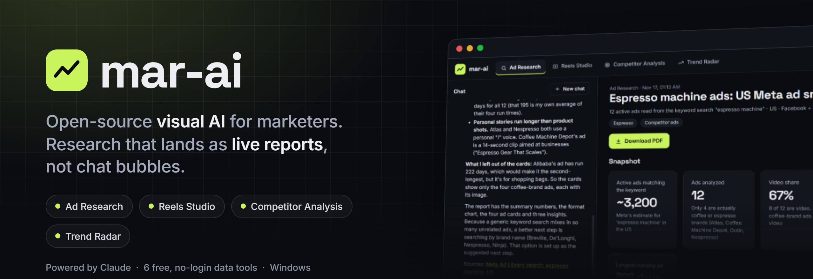
</picture>

<br>

**Reklam araştırması, Reels planlama, rakip analizi ve trend takibi —<br>uzun sohbet metinleri yerine canlı, etkileşimli raporlar olarak.**

<p>
  <a href="https://github.com/EthYusuf/mar-ai/releases/latest"><b>Windows için indir</b></a> &nbsp;·&nbsp;
  <a href="#-hızlı-başlangıç"><b>Hızlı başlangıç</b></a> &nbsp;·&nbsp;
  <a href="#-nasıl-çalışır">Nasıl çalışır</a> &nbsp;·&nbsp;
  <a href="docs/MCP-GELISTIRME.md">Kendi MCP'ni yaz</a> &nbsp;·&nbsp;
  <a href="README.md">English</a>
</p>

<p>
  <a href="https://github.com/EthYusuf/mar-ai/releases/latest"></a>
  <a href="https://github.com/EthYusuf/mar-ai/releases"></a>
  
  <a href="LICENSE"></a>
  <br>
  
  
  
  <a href="https://github.com/EthYusuf/mar-ai/actions/workflows/ci.yml"></a>
</p>

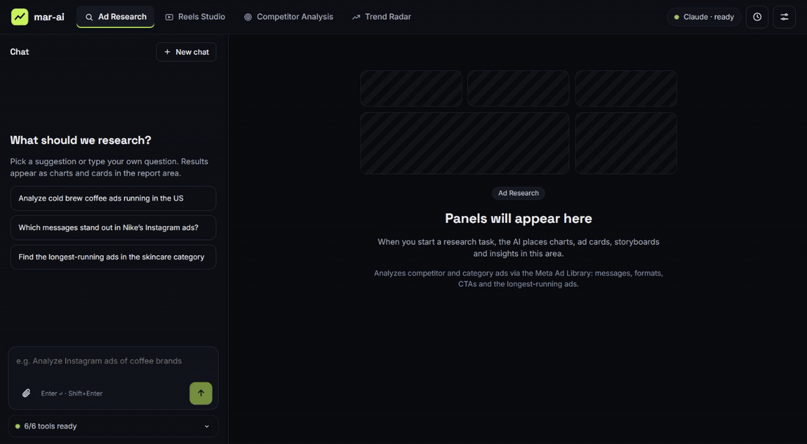

<sub><i>Gerçek, kurgusuz bir çalışma (hızlandırılmış): “ABD'deki espresso makinesi reklamlarını analiz et” → Meta Reklam Kütüphanesi → KPI'lar, format grafiği, reklam kartları ve içgörülerle canlı rapor. Demolar İngilizce arayüzle kaydedildi; uygulama tamamen Türkçe kullanılabilir.</i></sub>

</div>

<br>

## ✨ Neden mar-ai?

Çoğu yapay zeka asistanı pazarlama sorularına paragraflarla cevap verir. Pazarlamacıların ise **gösterebilecekleri kanıta** ihtiyacı var: sayılar, grafikler, gerçek reklamlar, video editörüne teslim edilebilecek bir plan. mar-ai, Claude'u gerçek ve herkese açık veri kaynaklarıyla birleştirir ve cevabı sohbetin yanındaki profesyonel bir rapor alanına çizer.

<table>
<tr>
<td width="50%" valign="top">

**📊 Sohbet balonu değil, rapor**<br>
KPI kartları, üzerine gelince detay gösteren çubuk/sütun/çizgi grafikler, gerçek kreatiflerle reklam ve gönderi kartları, sahne sahne storyboard, tablolar ve içgörüler. Rapor tek tıkla PDF olur.

</td>
<td width="50%" valign="top">

**🔑 Kendi Claude'un, API anahtarı yok**<br>
Claude Code motoru uygulamayla birlikte gelir ve <i>senin</i> Claude oturumunla çalışır. Resmi Claude Code penceresinde bir kez giriş yaparsın; uygulamada API anahtarı alanı yoktur.

</td>
</tr>
<tr>
<td valign="top">

**🌐 Gerçek veri, asla giriş yok**<br>
Altı yerleşik MCP sunucusu <i>ücretsiz, herkese açık, girişsiz</i> kaynakları okur: Meta Reklam Kütüphanesi, herkese açık Instagram sayfaları, YouTube RSS, Google Trends ve Haberler, Wikimedia ve headless tarayıcıyla herhangi bir web sitesi.

</td>
<td valign="top">

**🧩 MCP odaklı ve açık kaynak**<br>
Her veri kaynağı <code>mcps/</code> altında küçük bir MCP sunucusudur. Klasörü ekle, sürüm etiketle; kurulu tüm uygulamalar kendini günceller. MIT lisanslı.

</td>
</tr>
</table>

<details>
<summary><b>İçindekiler</b></summary>

- [Özellikler](#-özellikler)
  - [Reklam Araştırması](#-reklam-araştırması) · [Reels Stüdyosu](#-reels-stüdyosu) · [Rakip Analizi](#-rakip-analizi) · [Trend Radar](#-trend-radar)
  - [Kendine göre ayarla](#-kendine-göre-ayarla) · [Computer use](#%EF%B8%8F-computer-use-ve-her-chromium-tarayıcı)
- [Yerleşik veri kaynakları (MCP)](#-yerleşik-veri-kaynakları-mcp)
- [Nasıl çalışır](#-nasıl-çalışır)
- [Hızlı başlangıç](#-hızlı-başlangıç)
- [Örnek komutlar](#-örnek-komutlar)
- [Kaynaktan derleme](#%EF%B8%8F-kaynaktan-derleme)
- [mar-ai'yi genişlet](#-mar-aiyi-genişlet)
- [Gizlilik ve veri etiği](#-gizlilik-ve-veri-etiği)
- [Yol haritası](#%EF%B8%8F-yol-haritası) · [SSS](#-sık-sorulan-sorular) · [Katkı](#-katkıda-bulun) · [Lisans](#-lisans)

</details>

<br>

## 🚀 Özellikler

### 🔍 Reklam Araştırması

**Meta Reklam Kütüphanesi'nde** (Facebook + Instagram reklamları) anahtar kelime veya markayla, istediğin ülke ve platformda arama yapar. mar-ai reklamları bir ziyaretçi gibi okur ve rapora dönüştürür:

- **Format dağılımı** (video / görsel / carousel), en çok kullanılan **CTA'lar**, hedef alan adları ve en çok reklam veren markalar
- Her reklamın **kaç gündür yayında** olduğu: uzun yayında kalan reklamlar genelde kârlıdır, mar-ai bu "kazananları" öne çıkarır
- Gerçek kreatif, kanca, metin, CTA ve kısa bir *neden işe yarıyor* analiziyle **reklam kartları**
- Rakip sitelerinde **piksel tespiti** (Meta Pixel, TikTok Pixel, Google Ads, GA4…): hangi kanallara para harcadıklarını gösterir

<table>
<tr>
<td width="50%">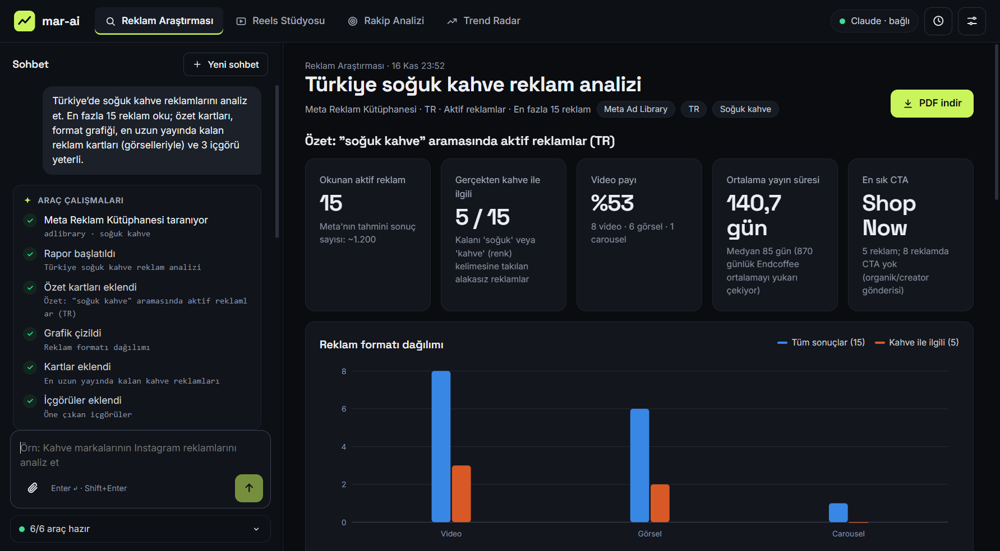<br><sub>Türkçe arayüz: "soğuk kahve" reklam analizi</sub></td>
<td width="50%">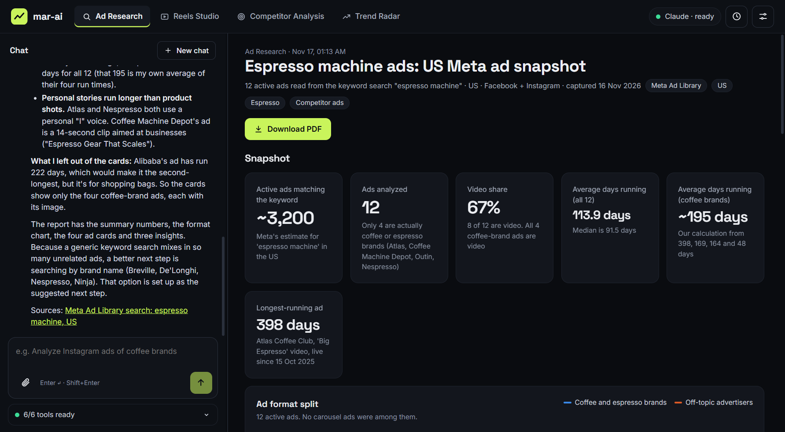<br><sub>İngilizce arayüz: espresso makinesi reklamları</sub></td>
</tr>
</table>

<details>
<summary><b>Raporun tamamını gör</b> (KPI'lar → grafik → reklam kartları → içgörüler)</summary>
<br>
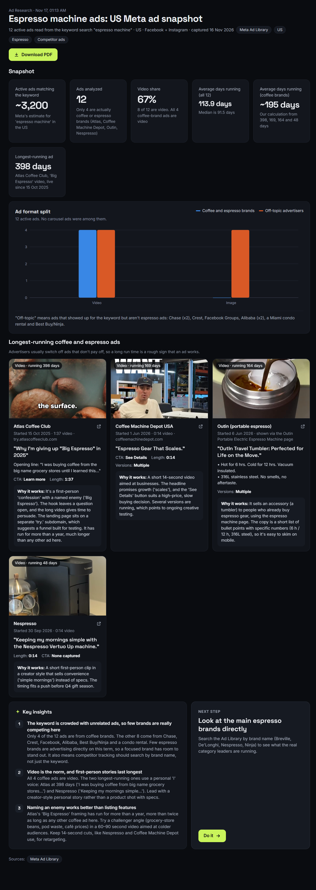
</details>

### 🎬 Reels Stüdyosu

Instagram Reels, TikTok ve YouTube Shorts için kısa video planı: **puanlı üç kanca (hook) alternatifi**, etkileşimli **zaman çizelgesi**, 9:16 karelerle **sahne sahne storyboard** (ekran yazısı, çekim tipi, ses), kopyalanmaya hazır açıklama metni, hashtagler, müzik yönü ve yayın önerisi.

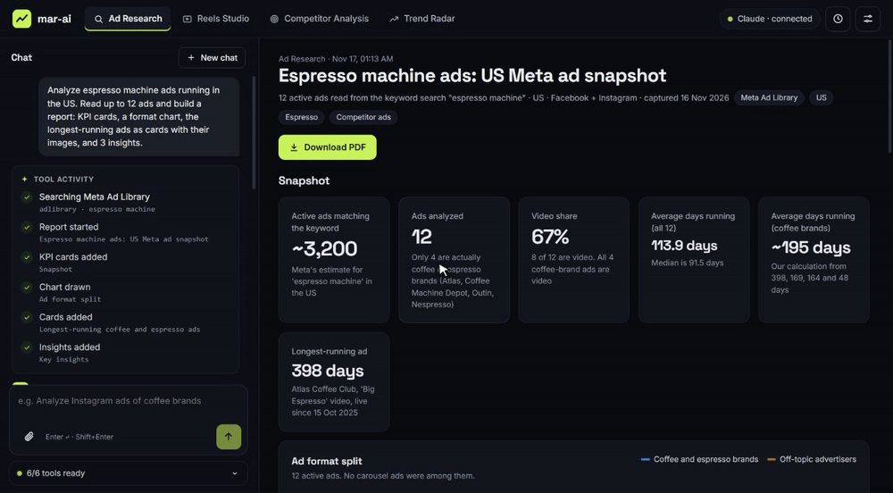

<details>
<summary><b>Türkçe arayüzde storyboard</b></summary>
<br>
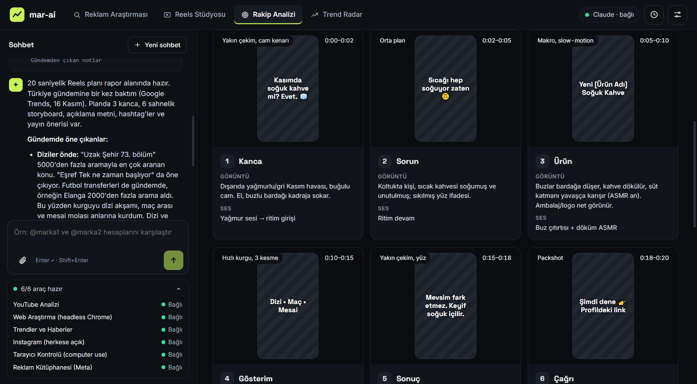
</details>

### 🎯 Rakip Analizi

Markaları kanal kanal yan yana koyar:

| Kanal | mar-ai neyi ölçer |
|---|---|
| **Instagram** (herkese açık profiller) | takipçi, ortalama beğeni ve yorum, **etkileşim oranı**, Reels oranı, paylaşım sıklığı, en çok kullanılan hashtagler, en iyi gönderi |
| **YouTube** | ortalama ve medyan izlenme, haftalık yükleme, **Shorts oranı** ve Shorts / uzun video performansı, en iyi gün, en çok izlenen videolar |
| **Web sitesi** | pazarlama ve SEO sağlık puanı, Open Graph / sosyal kartlar, yapılandırılmış veri, sayfa ağırlığı, **reklam ve analitik pikselleri** |

### 📈 Trend Radar

İnsanların **şu an** ne aradığını yakala (her ülke için Google Trends günlük beslemesi), bir marka veya konuyla ilgili haberleri izle (Google News, günlük haber hacmi ve en çok yazan kaynaklarla) ve en fazla beş konunun **zaman içindeki ilgisini** Wikimedia görüntülenmeleriyle karşılaştır.

<table>
<tr>
<td width="50%">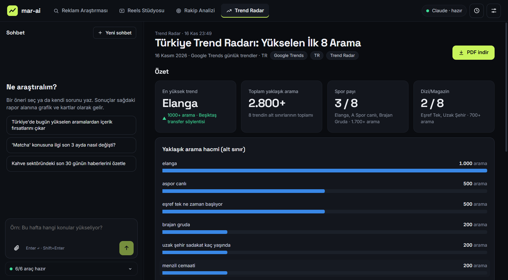<br><sub>Türkiye trend radarı</sub></td>
<td width="50%">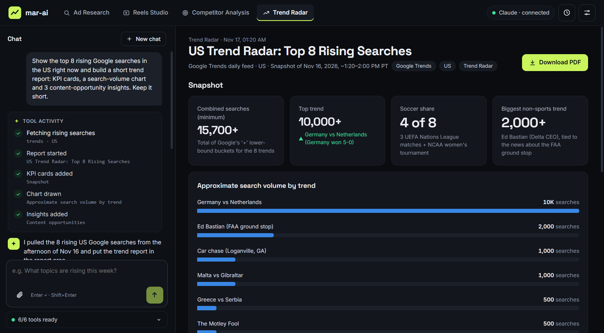<br><sub>ABD trend radarı</sub></td>
</tr>
</table>

### 🎨 Kendine göre ayarla

İlk açılış sihirbazı **dil, tema ve vurgu rengini** sorar, Claude bağlantısını kontrol eder ve hangi tarayıcının kullanılacağını gösterir. Sonradan her şey değiştirilebilir: koyu / açık / sistem tema, dört vurgu rengi, rahat veya sıkı yoğunluk, sohbet solda veya sağda ve raporu istediğin kadar genişletmek için **sürüklenebilir ayraç**.

<table>
<tr>
<td width="50%" valign="top">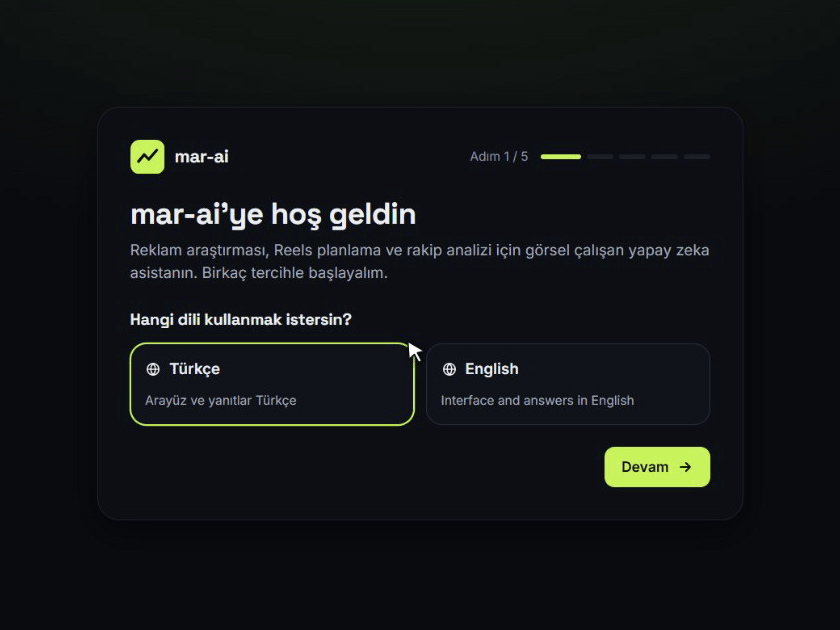<br><sub>İlk açılış sihirbazı</sub></td>
<td width="50%" valign="top">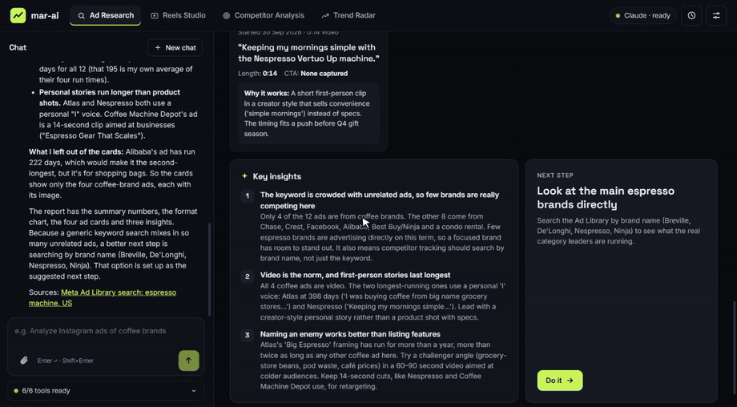<br><sub>Panel genişliği, tema, vurgu rengi ve yerleşim</sub></td>
</tr>
<tr>
<td width="50%">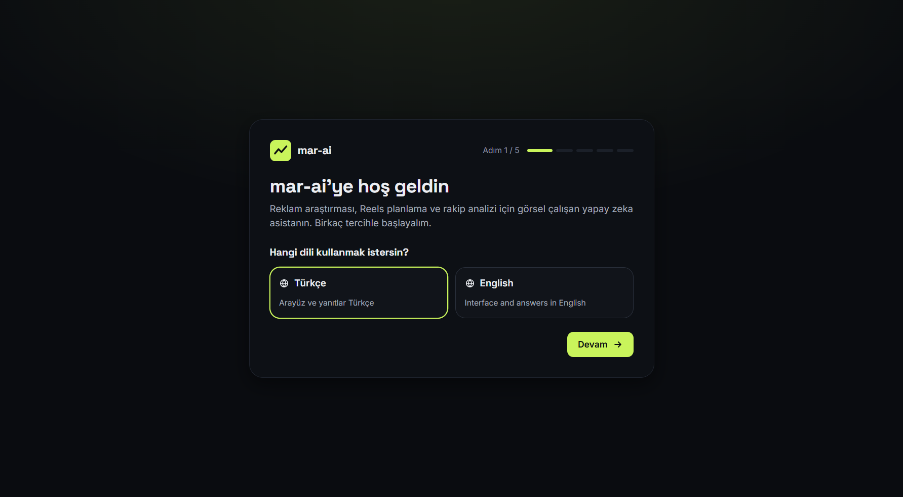<br><sub>Türkçe ilk açılış</sub></td>
<td width="50%">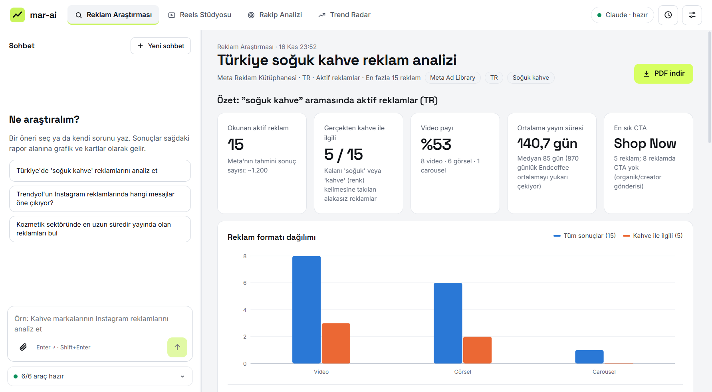<br><sub>Açık tema</sub></td>
</tr>
</table>

### 🖱️ Computer use ve her Chromium tarayıcı

**browser** MCP'si yapay zekanın gerçek bir tarayıcıyı adım adım kullanmasını sağlar: aç, oku, tıkla, yaz, kaydır ve gerçekten "gördüğü" ekran görüntüleri al. Varsayılan olarak **arka planda (headless)** çalışır; Ayarlar'daki tek bir anahtarla görünür pencerede izleyebilirsin.

mar-ai zaten sahip olduğun tarayıcıyı kullanır: **Chrome → Edge → Brave → Vivaldi → Chromium → Opera → Opera GX**. Edge her Windows'ta bulunduğu için Opera veya Firefox kullananlar da sorunsuz çalışır. Bulunan tarayıcılardan birini ya da özel bir yolu seçebilirsin. Tarayıcı her zaman **kendi boş profiliyle** açılır; çerezlerine, oturumlarına ve şifrelerine asla dokunulmaz.

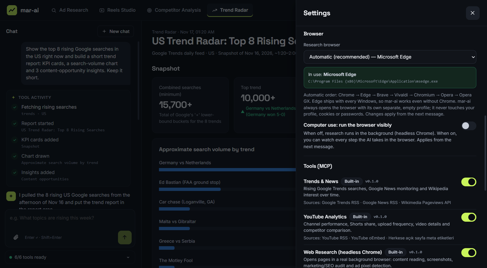

### Ve dahası

- 🗂️ **Geçmiş**: her sohbet ve raporu bilgisayarında saklanır, kaldığın yerden devam edebilirsin
- 📎 **Ekler**: görsel, PDF, CSV veya metin dosyası ekle (örneğin kendi Instagram İstatistikleri dışa aktarımın)
- 📄 Yazdırmaya uygun açık düzenle **PDF çıktısı**
- 🔄 GitHub Releases'ten **otomatik güncelleme**; yeni MCP'ler de böyle gelir
- 🌍 **Türkçe ve İngilizce** arayüz; yapay zeka senin dilinde cevap verir

<p align="right"><a href="#readme-top">↑ başa dön</a></p>

## 🧰 Yerleşik veri kaynakları (MCP)

Altısı da ücretsizdir, **API anahtarı ve giriş istemez**; nazik olmak için istekler aralıklandırılır ve önbelleğe alınır.

| MCP | Araçlar | Kaynak |
|---|---|---|
| `adlibrary` · Reklam Kütüphanesi (Meta) | `meta_ads_search` · `meta_ads_screenshot` | Meta Ad Library herkese açık sayfaları |
| `instagram` · Instagram (herkese açık) | `instagram_profile` · `instagram_post` · `instagram_compare` | Herkese açık profil ve gönderi sayfaları (ziyaretçi görünümü) |
| `youtube` · YouTube Analizi | `youtube_channel` · `youtube_video` · `youtube_compare` | YouTube RSS, oEmbed, herkese açık sayfa meta verileri |
| `trends` · Trendler ve Haberler | `trending_now` · `news_search` · `interest_over_time` | Google Trends RSS, Google News RSS, Wikimedia Pageviews API |
| `web` · Web Araştırma | `web_read` · `web_screenshot` · `site_audit` | Headless tarayıcıyla herkese açık web sayfaları |
| `browser` · Tarayıcı Kontrolü | `browser_open` · `browser_click` · `browser_type` · `browser_scroll` · `browser_screenshot` · … | Gerçek tarayıcıda computer use |

Bunlara ek olarak Claude yerleşik **WebSearch** ve **WebFetch** araçlarını ve raporu çizen uygulama içi **panels** sunucusunu (`report_start`, `show_kpis`, `show_chart`, `show_cards`, `show_storyboard`, `show_insights`, `show_table`, `show_text`) kullanır.

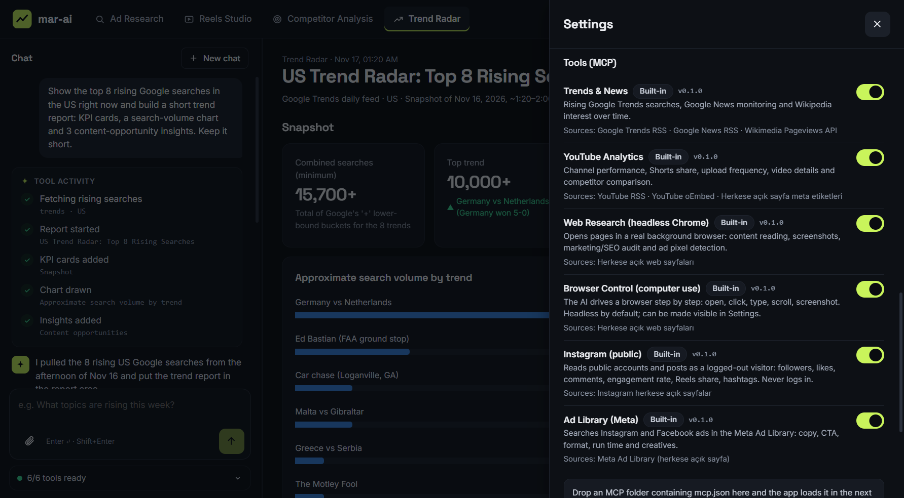

## 🧠 Nasıl çalışır?

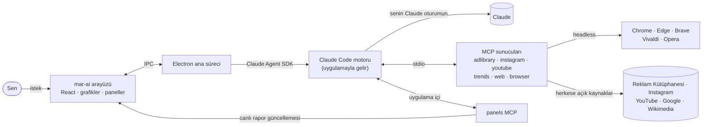

1. Dört modülden birinde isteğini yazarsın; modül, Claude'a hangi iş akışında olduğunu bildiren bağlam ekler.
2. Uygulamayla gelen **Claude Code motoru** (Claude Agent SDK üzerinden) işi planlar ve gerçek veriyi getiren **MCP sunucularını** çağırır.
3. Her şeyi sohbete dökmek yerine **panel araçlarını** çağırır; uygulama bunları anında KPI kartı, grafik, reklam kartı ve storyboard olarak çizer.
4. **Skill'ler** (`plugin/skills/*`) Claude'a her iş akışını öğretir: hangi araçları çağıracağını, nasıl analiz edeceğini, hangi panelleri çizeceğini.
5. Sohbet kısa kalır: ne yapıldı, en önemli bulgular ve rapora yönlendirme.

<p align="right"><a href="#readme-top">↑ başa dön</a></p>

## ⚡ Hızlı başlangıç

| Platform | İndir | Not |
|---|---|---|
| **Windows 10 / 11** (x64) | [`mar-ai-Setup-x.y.z.exe`](https://github.com/EthYusuf/mar-ai/releases/latest) | Şimdilik imzasız: SmartScreen → **Ek bilgi → Yine de çalıştır** |
| macOS · Linux | Kaynaktan derle | Paketli sürümler [yol haritasında](#%EF%B8%8F-yol-haritası) |

**Gereksinimler**

- **Claude Pro veya Max** aboneliği ve [Claude Code](https://code.claude.com/docs/en/setup)'a bir kerelik giriş (terminalde `claude` yaz ve giriş yap)
- Herhangi bir Chromium tarayıcı: Chrome, Edge (Windows'ta hazır gelir), Brave, Vivaldi veya Opera

**İlk açılış**

1. mar-ai'yi kur ve aç.
2. Dili, temayı ve vurgu rengini seç.
3. *Claude bağlantısı* adımında **Bağlantıyı test et**'e bas. Oturum bulunmazsa **Claude ile giriş yap** resmi Claude Code penceresini açar.
4. Bir modül seç (Reklam Araştırması, Reels Stüdyosu, Rakip Analizi, Trend Radar) ve bir öneriyle ya da kendi isteğinle başla.

## 💬 Örnek komutlar

| Modül | Dene |
|---|---|
| Reklam Araştırması | *Trendyol'un Türkiye'deki Instagram reklamlarını analiz et. En uzun yayında kalan kancalar ve CTA'lar hangileri?* |
| Reels Stüdyosu | *Yeni soğuk kahvemiz için 30 saniyelik bir Reels planla: puanlı 3 kanca, storyboard, açıklama metni ve hashtagler.* |
| Rakip Analizi | *@starbucks_tr ve @kahvedunyasi hesaplarını Instagram ve YouTube'da karşılaştır. Gönderi başına kim daha çok etkileşim alıyor?* |
| Trend Radar | *Türkiye'de bugün yükselen aramalardan bir kahve markası için üç içerik fikri çıkar.* |

## 🛠️ Kaynaktan derleme

**Gereksinimler:** Node.js 22+ ve npm, Windows 10/11 (geliştirme macOS / Linux'ta da çalışır).

```bash
git clone https://github.com/EthYusuf/mar-ai.git
cd mar-ai
npm install

npm run dev          # Vite anlık yenileme + Electron
npm start            # üretim derlemesi ve başlatma
npm run test:mcps    # tüm MCP'leri gerçek kaynaklara karşı test et (tek sunucu: npm run test:mcps -- youtube)
npm run typecheck    # TypeScript denetimi
npm run dist         # Windows kurulum dosyası → release/
```

<details>
<summary><b>Proje yapısı</b></summary>

```
electron/        ana süreç: Claude motoru, MCP kayıt defteri, panel araçları, otomatik güncelleme, PDF
src/             React arayüzü: ilk açılış, sohbet, rapor panelleri, grafikler, ayarlar
shared/          ana süreç ve arayüz ortak türleri, tarayıcı tespiti
mcps/            MCP sunucuları (her biri: mcp.json + src/index.ts) ve ortak yardımcılar (mcps/_shared)
plugin/skills/   Claude skill'leri: reklam araştırması, Reels planlama, rakip analizi, trend radarı
scripts/         derleme, geliştirme, başlatma ve MCP test betikleri
docs/            rehberler ve README görselleri
```

</details>

## 🧩 mar-ai'yi genişlet

**Veri kaynağı ekle.** `mcps/<id>/mcp.json` ve `mcps/<id>/src/index.ts` oluştur. Derleme betiği onu paketler, kurulum dosyası taşır, uygulama açılışta yükler. Çekirdek kodda değişiklik gerekmez. Şablon ve ortak yardımcılarla tam rehber: **[docs/MCP-GELISTIRME.md](docs/MCP-GELISTIRME.md)**.

**İş akışı öğret.** Açık bir `description` ile `plugin/skills/<ad>/SKILL.md` ekle; Claude gerektiğinde yükler.

**Yayınla.** Sürümü artır ve etiketi gönder. GitHub Actions kurulum dosyasını derleyip yayınlar, kurulu tüm kopyalar kendini günceller:

```bash
git tag v0.2.0 && git push --tags
```

Kullanıcılar kendi MCP klasörlerini `%APPDATA%\mar-ai\mcps` içine de koyabilir (*Ayarlar → Araçlar → Kendi MCP klasörünü aç*).

<p align="right"><a href="#readme-top">↑ başa dön</a></p>

## 🔒 Gizlilik ve veri etiği

- **Yalnızca herkese açık veri.** mar-ai hiçbir yere giriş yapmaz, parola alanlarına yazmaz, gizli API kullanmaz ve hiçbir uygulamayı taklit etmez.
- **Tarayıcın sana ait kalır.** Araştırmalar ayrı ve boş bir tarayıcı profilinde çalışır.
- **Önce yerel.** Ayarlar, sohbetler ve raporlar bilgisayarında (`%APPDATA%\mar-ai`) saklanır. İstekler kendi Claude Code oturumun üzerinden Claude'a gider; mar-ai'nin sunucusu yoktur, oraya hiçbir şey gönderilmez.
- **Nazik tasarım.** İstekler aralıklandırılır ve önbelleğe alınır. mar-ai bir araştırma asistanıdır, toplu veri kazıma aracı değildir.
- Platformlar giriş yapmamış ziyaretçilere gösterdiklerini değiştirebilir veya erişimi geçici olarak sınırlayabilir; araçlar bunu açıkça bildirir. Platformların kullanım koşullarına uymak kullanıcının sorumluluğundadır; mar-ai kişisel hesaplar için değil, markaların herkese açık içerikleri için tasarlanmıştır.

## 🗺️ Yol haritası

- [x] Canlı rapor panelleri ve PDF çıktısıyla dört modül
- [x] Girişsiz altı MCP sunucusu, computer use, her Chromium tarayıcı
- [x] GitHub Releases ile otomatik güncelleme
- [ ] İmzalı Windows kurulum dosyası (SmartScreen uyarısız)
- [ ] macOS ve Linux sürümleri
- [ ] Yeni kaynaklar: TikTok Creative Center, Google Ads Transparency Center, LinkedIn Ad Library
- [ ] Zamanlanmış raporlar (haftalık rakip özeti)
- [ ] İsteğe bağlı motorlar (Codex, Gemini CLI)
- [ ] Daha fazla arayüz dili

Bir fikrin mi var? [Özellik isteği aç](https://github.com/EthYusuf/mar-ai/issues/new?template=feature_request.yml).

## ❓ Sık sorulan sorular

<details>
<summary><b>Anthropic API anahtarı gerekiyor mu?</b></summary>

Hayır. mar-ai, Claude Code'a bir kez giriş yaparak oluşturduğun Claude oturumuyla çalışır; kullanım Claude aboneliğinden düşer. İleri düzey kullanıcılar Ayarlar'dan özel bir Claude Code yolu da gösterebilir.
</details>

<details>
<summary><b>Ücretli mi?</b></summary>

mar-ai ücretsiz ve açık kaynaktır (MIT). Yerleşik veri kaynaklarının hepsi ücretsizdir. Yalnızca kendi Claude aboneliğine (Pro veya Max) ihtiyacın var.
</details>

<details>
<summary><b>Instagram'a veya Facebook'a giriş yapıyor mu?</b></summary>

Asla. Yalnızca giriş yapmamış bir ziyaretçinin gördüğünü okur. Gizli hesaplar, hikayeler ve hashtag sayfaları kapsam dışıdır.
</details>

<details>
<summary><b>Chrome kullanmıyorum, çalışır mı?</b></summary>

Evet. Edge Windows'ta hazır gelir ve Chrome yoksa otomatik kullanılır. Brave, Vivaldi, Chromium, Opera ve Opera GX de tanınır; Ayarlar'dan istediğini seçebilirsin.
</details>

<details>
<summary><b>Verilerim nerede saklanıyor?</b></summary>

Bilgisayarında, `%APPDATA%\mar-ai` klasöründe (ayarlar, sohbetler, raporlar, tarayıcı profili). Uygulamayı sıfırlamak için bu klasörü silmen yeterli.
</details>

<details>
<summary><b>Kurulumda neden SmartScreen uyarısı çıkıyor?</b></summary>

Kurulum dosyası henüz dijital olarak imzalı değil. <i>Ek bilgi → Yine de çalıştır</i> seçeneğiyle devam edebilirsin. İmzalama yol haritasında.
</details>

## 🤝 Katkıda bulun

Katkılar çok değerli: yeni MCP sunucuları, skill'ler, paneller, çeviriler ve hata düzeltmeleri. **[CONTRIBUTING.md](CONTRIBUTING.md)** dosyasını oku, büyük değişiklikler için önce bir issue aç ve [good first issue](https://github.com/EthYusuf/mar-ai/labels/good%20first%20issue) etiketlerine göz at.

mar-ai pazarlama işine yarıyorsa **bir ⭐ bırak**; başka pazarlamacıların bulmasına yardımcı olur.

## 🙏 Teşekkürler

[Claude Agent SDK](https://code.claude.com/docs/en/agent-sdk/overview) · [Model Context Protocol](https://modelcontextprotocol.io) · [Electron](https://www.electronjs.org) · [React](https://react.dev) · [Vite](https://vite.dev) · [Puppeteer](https://pptr.dev) · Fontsource üzerinden [Inter](https://rsms.me/inter/) ve [Space Grotesk](https://fonts.google.com/specimen/Space+Grotesk) · [Shields.io](https://shields.io)

mar-ai bağımsız bir açık kaynak projesidir; Anthropic, Meta, Google veya YouTube ile bağlantılı değildir ve onlar tarafından onaylanmamıştır. Ürün adları sahiplerinin ticari markalarıdır.

## 📄 Lisans

[MIT](LICENSE) © mar-ai contributors. Uygulamayla gelen Claude Agent SDK ve Claude Code motoru [Anthropic'in Ticari Kullanım Koşulları'na](https://www.anthropic.com/legal/commercial-terms) tabidir.

<p align="right"><a href="#readme-top">↑ başa dön</a></p>
